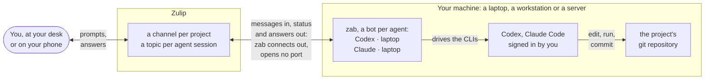
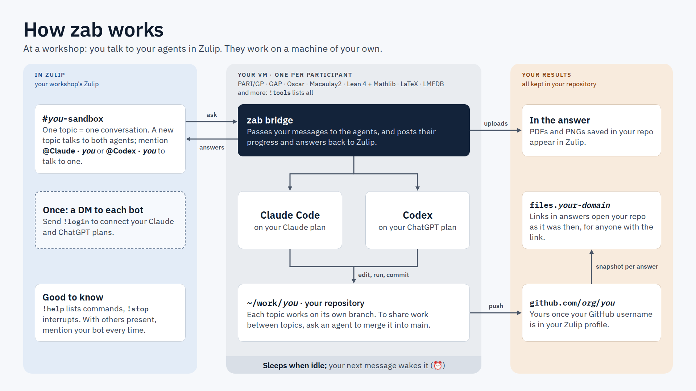
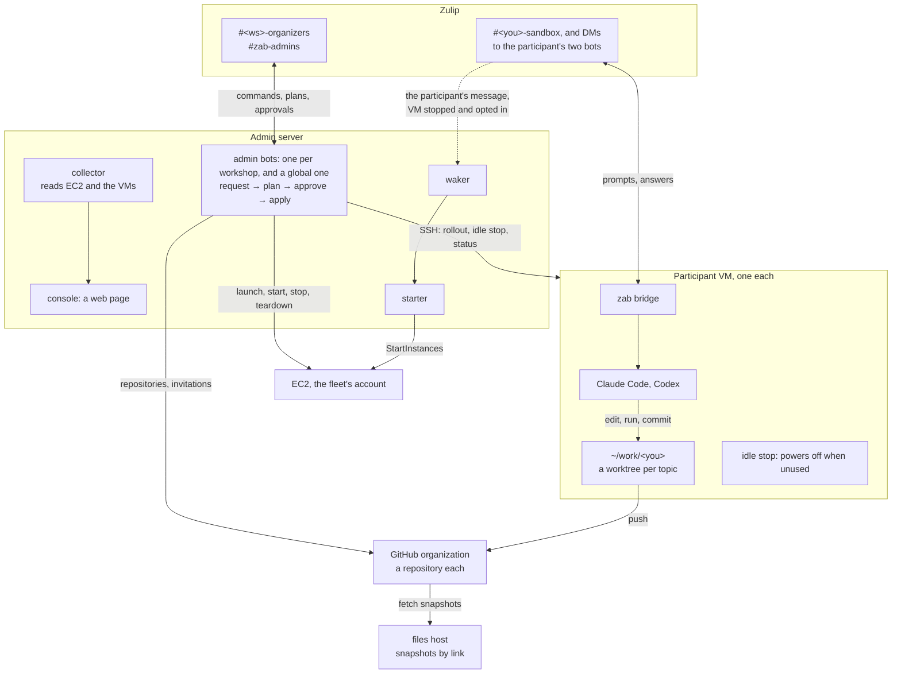

# zab: Zulip Agent Bridge

zab lets you drive coding agents, [OpenAI Codex](https://github.com/openai/codex) and [Claude Code](https://www.anthropic.com/claude-code), running on your own machines, from [Zulip](https://zulip.com):

- a **channel** is a project (a git repository);
- a **topic** is one agent session;
- the bot posts a session card, one status message per turn (edited as the agent works), and the agent's answer, with working links to the files it touched and rendered math.

**On your own machines, there is no server to run.** Each person runs `zab` on each machine where their agents live, and it opens no port and makes only outbound connections. Zulip holds the searchable record of every session, so you can start work at your desk, follow it from your phone, and point a colleague at the topic. A workshop adds servers of its own: an admin server and a files host ([The workshop toolkit](#the-workshop-toolkit)).



*On your own machines. By default a project's topics share one checkout of its repository (`default_workspace`, [SPEC §5.3](docs/SPEC.md#53-profiles)); a workshop's VMs give each topic a branch and a worktree of its own.*

## Who it is for

- **A mathematician (or anyone) who runs Claude Code or Codex** on a laptop, a workstation or a server, and wants to drive the sessions from Zulip, keep a record of them, and share them with collaborators.
- **Workshop organizers** who give each participant a cloud VM running both agents, with their own Zulip bots, and run the whole fleet from Zulip. zab was built for, and first used at, workshops on coding agents for number theorists in October 2026.

## Prerequisites

- **Linux** with systemd (zab installs user services), or **macOS** (run `zab run` in the foreground).
- **Python 3.12 or newer** and **git 2.41 or newer**. [uv](https://docs.astral.sh/uv/) provides Python if you lack it.
- **The agents:** the Codex CLI or Claude Code, or both, installed on the machine and signed in by you. The versions zab is tested with are pinned in [`docs/DECISIONS.md`](docs/DECISIONS.md) (Pins); `zab doctor` warns about others.
- **A Zulip organization** where you can create a *generic bot* for each agent on each machine, and download its zuliprc (*Personal settings → Bots*).

## Install

Each release tag is signed with the maintainer's SSH key, which [`SECURITY.md`](SECURITY.md#verifying-a-release) publishes with the commands to check a tag. Use the latest, the newest of the repository's [tags](https://github.com/MathAgents/zulip-agent-bridge/tags):

```bash
uv tool install git+https://github.com/MathAgents/zulip-agent-bridge@vX.Y.Z
zab init --profile personal --bot codex --zuliprc ~/Downloads/codex-zuliprc --backend codex
zab init --bot claude --zuliprc ~/Downloads/claude-zuliprc --backend claude
zab doctor
zab service install          # Linux: systemd user services. On macOS, run `zab run`
```

`zab init` checks each bot against Zulip and writes `~/.config/zab/config.toml`. `--profile personal`, the default, is the profile for your own machines: shared workspaces, Codex's `workspace-write` sandbox and Claude Code without permission prompts. The other profile, `workshop`, is for the workshop VMs ([SPEC §5.3](docs/SPEC.md#53-profiles)). [`config/zab.example.toml`](config/zab.example.toml) annotates every setting. Run `zab init` again to add a bot or change one.

`zab service install` asks for nothing, but prints a `sudo loginctl enable-linger` command when your user needs it to run services while logged out. `zab service status` shows the units and `zab service uninstall` removes them. To give both services a Python environment of yours, set `service_path_prepend = ["~/venv/bin"]` and `service_env = { VIRTUAL_ENV = "~/venv" }` under `[bridge]`, then install again.

## Quickstart

1. Map a channel to a git repository on the machine: a `[[projects]]` entry for that channel in `~/.config/zab/config.toml`, or `default_project` for every channel ([SPEC §5.4](docs/SPEC.md#54-resolving-a-channel-to-a-project)). Then subscribe your bots to the channel, a **private** one.
2. Start a topic and mention a bot: `@**Codex · laptop** list the files and summarize the README`. A 👀 means a turn started. The status message ends as ✅ **Done**, followed by the answer.
   - **Without a mention,** in a channel where you are the only person, every message goes to every bot of the machine, whatever earlier messages addressed, each in its own session; a mention, `@**Codex · laptop**` or a typed `@codex`, talks only to the bots it names. With bots of several machines in the channel, each machine's bots answer such a message, so mention the one you mean. With other people in the channel, every message needs a mention ([SPEC §4.5](docs/SPEC.md#45-routing-rules), "A message without a mention").
3. Keep writing in the topic to continue the session. `!stop` interrupts a turn and `!help` lists the commands.

[`docs/quickstart.md`](docs/quickstart.md) is the participants' guide at a workshop. Its sections on talking to the agents, on working with others and on the commands hold on your own machines too; the rest, the VM, its software and the file links, is the workshop's.

## The workshop toolkit

Everything a workshop needs beyond the bridge is in `workshop/`, with its runbooks in `docs/`. Each participant gets a cloud VM of their own, running both agents behind their own two bots. The organizers run the fleet from Zulip, through an admin server: it holds the fleet's keys, runs no agent, and changes nothing until an organizer approves.



*At a workshop, from a participant's side. The deployment behind it:*



In Zulip, the admin bots act through the `zab-provisioner` account, which owns each participant's two bots and makes their sandbox. When a participant writes to one of their bots while their VM is stopped, and the VM is opted in, the waker has the starter start it; nobody else's message wakes it. A wake that fails is reported in the workshop's `#<ws>-fleet-alerts` channel.

| Part | What it is | Read |
|---|---|---|
| **The image** | An Ubuntu AMI with both agents, Lean and Mathlib, PARI/GP, GAP, Julia and Oscar, Macaulay2 and more, each checked by a real computation at build time. SageMath and Magma are optional components; Magma needs the deployer's own licence. | [`workshop/ami/README.md`](workshop/ami/README.md), [`workshop/aws/README.md`](workshop/aws/README.md) |
| **The admin server and its bots** | One server for several workshops. Each workshop has an admin bot of its own, in its organizers' channel, and a global admin bot in `#zab-admins` creates new workshops (`!new-workshop`) and reports wakes that no message explains. Rosters, provisioning, rollouts, keeping and ending VMs: each change is a plan the bot shows first, and nothing happens until an organizer approves it. The server also runs the waker and its starter, the collector and the console. | [`docs/ORGANIZERS.md`](docs/ORGANIZERS.md) (organizers), [`docs/NEW-WORKSHOP.md`](docs/NEW-WORKSHOP.md) (global admins), [`docs/ADMIN.md`](docs/ADMIN.md) (design), [`docs/BOOTSTRAP.md`](docs/BOOTSTRAP.md) (the deployer's one-time setup), [`workshop/adminserver/README.md`](workshop/adminserver/README.md) (its services) |
| **The console** | A read-only web page of the fleet, for organizers, from what the collector gathers. | [ADMIN §4](docs/ADMIN.md#4-the-read-only-console) |
| **Idle stop and the waker** | Each VM powers itself off after a time without use, set per VM from 10 to 240 minutes. A rollout sets 60 minutes by default on each VM whose waker is on. The waker, on the admin server, starts a stopped VM again when its participant writes to one of their bots; it asks the starter, the one process that calls `StartInstances` for it. | [ORGANIZERS §4.2](docs/ORGANIZERS.md#42-idle-stop-and-the-waker), [ADMIN §1.2](docs/ADMIN.md#12-processes) |
| **The files host** | Serves each turn's files and rendered pages by capability link, so links in Zulip work for anyone they are shared with. It fetches the snapshots that the VMs push to GitHub. For now, it and the bridge's links to it serve only repositories of the GitHub organization `MathAgents`: in another organization, answers carry no such links. | [`workshop/files/README.md`](workshop/files/README.md) |

Every step of the admin bot is a script that a deployer can also run by hand, the fallback when the bot can't ([ORGANIZERS §7](docs/ORGANIZERS.md#7-when-the-bot-cant-the-manual-fallback)): [`workshop/admin/README.md`](workshop/admin/README.md) and [`workshop/aws/README.md`](workshop/aws/README.md).

**What a workshop needs:**

- **an AWS account** for the fleet, the admin server and the files host, with the vCPU and Elastic IP quotas for one VM per participant ([BOOTSTRAP §6.4](docs/BOOTSTRAP.md#64-quotas-in-each-region));
- **a Zulip organization** that you own, with one `zab-provisioner` account, a Moderator, which owns the participants' bots;
- **a GitHub organization** for the participants' repositories, and a token for it;
- **a domain,** for the console (`admin.<your domain>`) and the files host (`files.<your domain>`);
- **the agents' plans:** each participant signs in to Claude Code with a Claude plan and to Codex with a ChatGPT plan, their own or one the workshop gives them;
- **a dedicated SSH key** for the deployer, never on a machine where coding agents run: it signs the releases the server deploys ([BOOTSTRAP §2](docs/BOOTSTRAP.md#2-ssh-tag-signing)).

**Setting up, in order,** for the deployer:

1. **The image:** build it once ([`workshop/ami/README.md`](workshop/ami/README.md); the build takes about 70 minutes), then copy it into each region your workshops use ([BOOTSTRAP §6.1](docs/BOOTSTRAP.md#61-the-fleets-security-group-and-image-per-region)).
2. **The files host:** [`workshop/files/README.md`](workshop/files/README.md). The admin server's configuration names its address.
3. **The admin server,** its global admin bot and a first workshop, once: [`docs/BOOTSTRAP.md`](docs/BOOTSTRAP.md).
4. **Each later workshop:** a global admin's `!new-workshop` in `#zab-admins`: [`docs/NEW-WORKSHOP.md`](docs/NEW-WORKSHOP.md).
5. **Running a workshop,** from roster to teardown: the organizers' runbook, [`docs/ORGANIZERS.md`](docs/ORGANIZERS.md).

## Security model, in brief

- **zab never reads, copies or stores agent credentials:** no credential files and no tokens. The CLI alone handles them ([SPEC §1.2](docs/SPEC.md#12-non-goals-for-phase-1), [§4.6](docs/SPEC.md#46-commands), [§12](docs/SPEC.md#12-security-model); DECISIONS D5, D24). You sign in to each agent with its own CLI, or with `!login` in a direct message to its bot, which starts the CLI's own sign-in. zab relays the sign-in link and, for Claude Code, the one-time code you paste back, which goes to the CLI once and is never echoed, stored or logged.
- **A bot obeys only its allowed users:** the people in `allow_user_ids` and `allow_emails`, or else the bot's Zulip owner (DECISIONS D3). By default, sessions run only in private channels. Agent output can't ping a whole channel, and known secret formats are redacted from it.
- **zab doesn't sandbox the agents.** Claude Code runs without permission prompts and, on the workshop VMs, Codex runs with full access. Run the bridge only where you are content for the agent to act as you. The workshop VMs are disposable and hold no cloud credentials.
- **No shell strings.** Text from Zulip or from an agent never reaches a shell: zab runs commands as argument lists ([SPEC §10.6](docs/SPEC.md#106-rules-for-git-calls), [§12.1](docs/SPEC.md#121-threats-and-mitigations)).
- **Known residual risk:** the agent runs as your user, so it can read its bot's Zulip key, and with it post wherever the bot's owner can, private channels included ([SPEC §12.2](docs/SPEC.md#122-known-residual-risk-in-phase-1)). On your own machines the owner is you. On a workshop's VMs it is the `zab-provisioner` account, which owns every participant's bots (bots made by hand belong to whoever made them: [ADMIN §1.5](docs/ADMIN.md#15-threats)). `zab-provisioner` is a member of each workshop's `#<ws>-fleet-alerts` channel, and of its participants' channel if it has one ([BOOTSTRAP §5.4](docs/BOOTSTRAP.md#54-the-channels), [NEW-WORKSHOP](docs/NEW-WORKSHOP.md)). So an agent can post as its bot in those channels of every workshop on the server, and in public channels; so can its participant, who has sudo on the VM. The bot can't post in `#zab-admins` or an organizers' channel, which `zab-provisioner` is never in, and the admin bots never obey a bot.
- **The admin server holds the fleet's keys and acts on approvals.** Each change an organizer asks for is a plan that a human approves; ending VMs or deactivating bots takes a second approver, or a global admin. Once an approved plan opts a VM in, the waker starts it when its participant writes. The server deploys only release tags signed by the deployer's key ([ADMIN §1.6](docs/ADMIN.md#16-the-deploy-gate)).

## Status and support

zab is young. It is used at workshops and by its author day to day, and it changes quickly: read [`CHANGELOG.md`](CHANGELOG.md) before you upgrade. Issues and pull requests are welcome, but there is no support guarantee: see [`CONTRIBUTING.md`](CONTRIBUTING.md) for how changes are taken.

Development happens in a private repository, and each release is exported here as one commit with its tag. **References such as `#123`** in the code, the documents and the changelog point to the private development tracker, not to this repository's issues.

## Documents

| File | Purpose |
|---|---|
| [`docs/SPEC.md`](docs/SPEC.md) | The specification: the design and its rules, cited as "SPEC §n" |
| [`docs/DECISIONS.md`](docs/DECISIONS.md) | Decisions, version pins and the verification log |
| [`CHANGELOG.md`](CHANGELOG.md) | What each release changed |
| [`docs/quickstart.md`](docs/quickstart.md) | The participants' guide |
| [`docs/ORGANIZERS.md`](docs/ORGANIZERS.md), [`docs/NEW-WORKSHOP.md`](docs/NEW-WORKSHOP.md) | Running a workshop from Zulip |
| [`docs/ADMIN.md`](docs/ADMIN.md), [`docs/BOOTSTRAP.md`](docs/BOOTSTRAP.md) | The admin server: its design, and setting one up |
| [`workshop/adminserver/README.md`](workshop/adminserver/README.md) | The admin server's services, files and deploys |
| [`workshop/admin/README.md`](workshop/admin/README.md), [`workshop/aws/README.md`](workshop/aws/README.md) | The provisioning scripts, run by hand: the manual fallback |
| [`config/zab.example.toml`](config/zab.example.toml) | The annotated configuration |
| [`CONTRIBUTING.md`](CONTRIBUTING.md) | How to report problems, propose changes and run the tests |
| [`SECURITY.md`](SECURITY.md) | How to report a vulnerability, and what counts as one |

## License

MIT, copyright Andrew V. Sutherland: see [`LICENSE`](LICENSE).
